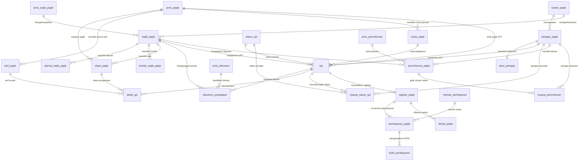

# Sistem Informasi Perpajakan (SIP)

Aplikasi web administrasi perpajakan berbasis **PHP Native (PHP 8+)** dan **MySQL**, dirancang khusus sebagai media pembelajaran dan portofolio implementasi basis data relasional tingkat lanjut untuk siswa **SMK Rekayasa Perangkat Lunak (RPL)**.

Aplikasi ini mendemonstrasikan implementasi nyata operasi **CRUD (Create, Read, Update, Delete)** pada **tepat 25 tabel database relasional** yang saling berhubungan dengan integritas referensial penuh (*Primary Key* dan *Foreign Key*), normalisasi database (1NF, 2NF, 3NF), keamanan web standar industri, dan dashboard visual analitik dinamis.

---

## Daftar Isi
1. [Tujuan Pembelajaran & Kompetensi Keahlian](#1-tujuan-pembelajaran--kompetensi-keahlian)
2. [Spesifikasi Teknologi](#2-spesifikasi-teknologi)
3. [Arsitektur Basis Data (25 Tabel Utama)](#3-arsitektur-basis-data-25-tabel-utama)
4. [Diagram Relasi Entitas (ERD)](#4-diagram-relasi-entitas-erd)
5. [Implementasi Relasi & Integritas Referensial](#5-implementasi-relasi--integritas-referensial)
6. [Fitur Unggulan Sistem & Dashboard](#6-fitur-unggulan-sistem--dashboard)
7. [Logika Bisnis Perpajakan (Business Logic)](#7-logika-bisnis-perpajakan-business-logic)
8. [Panduan Instalasi & Menjalankan di Laragon](#8-panduan-instalasi--menjalankan-di-laragon)
9. [Akun Login Pengujian (Demo Accounts)](#9-akun-login-pengujian-demo-accounts)
10. [Struktur Direktori Proyek](#10-struktur-direktori-proyek)
11. [Skenario Pengujian Praktik Mandiri Siswa (Lab Checklist)](#11-skenario-pengujian-praktik-mandiri-siswa-lab-checklist)
12. [Aspek Keamanan Aplikasi Web](#12-aspek-keamanan-aplikasi-web)

---

## 1. Tujuan Pembelajaran & Kompetensi Keahlian

Proyek ini disusun untuk memenuhi capaian pembelajaran pada mata pelajaran **Basis Data** dan **Pemrograman Web dan Perangkat Bergerak (PWPB)** di SMK RPL:

* **Pemodelan Data Relasional**: Merancang dan mengelola 25 tabel yang saling berelasi tanpa redundansi data anomali (*insertion*, *update*, *deletion anomaly*).
* **Normalisasi Database**: Memenuhi kaidah Bentuk Normal Pertama (1NF), Bentuk Normal Kedua (2NF), hingga Bentuk Normal Ketiga (3NF).
* **Integritas Relasi**: Menerapkan relasi *One-to-One*, *One-to-Many*, dan *Many-to-Many* dengan *Foreign Key Constraints* (InnoDB).
* **Manipulasi Data Lengkap (CRUD)**: Melakukan operasi *Create, Read, Update, Delete* yang terhubung nyata ke database MySQL.
* **Keamanan Perangkat Lunak**: Mencegah celah *SQL Injection* menggunakan **PDO Prepared Statements**, proteksi **CSRF Token**, proteksi **XSS** via sanitasi data, serta hashing password menggunakan algoritma **Bcrypt**.

---

## 2. Spesifikasi Teknologi

| Komponen | Spesifikasi / Alat | Keterangan |
| :--- | :--- | :--- |
| **Bahasa Pemrograman** | PHP 8.2+ (PHP Native) | Tanpa framework backend (Pure Native) |
| **Basis Data** | MySQL 8.0+ | Engine InnoDB, Strict Mode, Charset UTF-8 |
| **Driver Basis Data** | PDO (PHP Data Objects) | Menggunakan Prepared Statements 100% |
| **Frontend Framework** | Bootstrap 5.3 | Tersedia luring (offline bundle) di folder `assets/` |
| **Koleksi Ikon** | Bootstrap Icons 1.11 | Tersedia luring (webfonts woff & woff2) |
| **Visualisasi Grafik** | Chart.js 4.4.1 | Visualisasi tren pendapatan & status SPT |
| **Web Server Lokal** | Laragon (Apache 2.4 & MySQL 8.0) | Lingkungan server lokal cepat |
| **Database Manager** | phpMyAdmin / MySQL CLI | Untuk inspeksi dan eksekusi skema basis data |

---

## 3. Arsitektur Basis Data (25 Tabel Utama)

Basis data diberi nama **`db_perpajakan`**. Seluruh tabel dan kolom menggunakan **Bahasa Indonesia** dengan format identifier **`snake_case`**.

### Kelompok A: Data Kantor dan Petugas Pajak
1. **`kantor_pajak`**: Menyimpan data unit kantor perpajakan (KPP Pratama / Madya).
   - *Kolom*: `id_kantor` (PK), `kode_kantor`, `nama_kantor`, `alamat`, `kota`, `nomor_telepon`, `email`.
2. **`petugas_pajak`**: Menyimpan aparatur pemeriksa / Account Representative (AR).
   - *Kolom*: `id_petugas` (PK), `id_kantor` (FK), `nama_petugas`, `nomor_identitas` (NIP), `jabatan`, `nomor_telepon`, `email`, `status`.
3. **`akun_petugas`**: Kredensial login petugas perpajakan (*One-to-One* dengan petugas).
   - *Kolom*: `id_akun` (PK), `id_petugas` (FK, UNIQUE), `nama_pengguna` (UNIQUE), `kata_sandi`, `peran`, `status_akun`.

### Kelompok B: Data Wajib Pajak
4. **`jenis_wajib_pajak`**: Klasifikasi subjek pajak.
   - *Kolom*: `id_jenis_wajib_pajak` (PK), `nama_jenis` (Orang Pribadi, Badan Usaha, Bendaharawan), `keterangan`.
5. **`wajib_pajak`**: Data induk Wajib Pajak (WP).
   - *Kolom*: `id_wajib_pajak` (PK), `id_jenis_wajib_pajak` (FK), `id_kantor` (FK), `nomor_npwp` (VARCHAR), `nama_wajib_pajak`, `tanggal_pendaftaran`, `tanggal_lahir`, `jenis_kelamin`, `status_wajib_pajak`.
6. **`alamat_wajib_pajak`**: Entitas alamat domisili, korespondensi, maupun cabang usaha.
   - *Kolom*: `id_alamat` (PK), `id_wajib_pajak` (FK), `alamat_lengkap`, `provinsi`, `kota`, `kecamatan`, `kode_pos`, `jenis_alamat`.
7. **`kontak_wajib_pajak`**: Saluran komunikasi resmi wajib pajak.
   - *Kolom*: `id_kontak` (PK), `id_wajib_pajak` (FK), `nomor_telepon`, `email`, `jenis_kontak`.

### Kelompok C: Data Perpajakan
8. **`jenis_pajak`**: Master jenis pemungutan pajak negara.
   - *Kolom*: `id_jenis_pajak` (PK), `kode_pajak` (PPh 21, PPh 23, PPh Final, PPN, PBB), `nama_pajak`, `deskripsi`, `status`.
9. **`objek_pajak`**: Aset, penghasilan, atau transaksi yang dikenai pajak.
   - *Kolom*: `id_objek_pajak` (PK), `id_wajib_pajak` (FK), `id_jenis_pajak` (FK), `nama_objek`, `alamat_objek`, `nilai_objek`, `keterangan`.
10. **`tarif_pajak`**: Aturan persentase/skema pengenaan tarif pajak terkelola secara dinamis.
    - *Kolom*: `id_tarif` (PK), `id_jenis_pajak` (FK), `nama_tarif`, `jenis_perhitungan` (Persentase/Nominal Tetap), `nilai_tarif`, `tanggal_mulai`, `tanggal_berakhir`, `status`.
11. **`masa_pajak`**: Periode pelaporan pajak berkala (Masa bulanan / Tahunan).
    - *Kolom*: `id_masa_pajak` (PK), `id_jenis_pajak` (FK), `tahun_pajak`, `tanggal_mulai`, `tanggal_berakhir`, `batas_pelaporan`, `status`.

### Kelompok D: Dokumen Perpajakan
12. **`jenis_dokumen`**: Kategori dokumen kelengkapan administrasi.
    - *Kolom*: `id_jenis_dokumen` (PK), `nama_dokumen`, `deskripsi`.
13. **`dokumen_perpajakan`**: Arsip berkas digital yang diunggah.
    - *Kolom*: `id_dokumen` (PK), `id_wajib_pajak` (FK), `id_jenis_dokumen` (FK), `id_spt` (FK, Nullable), `nama_file`, `lokasi_file`, `tanggal_upload`, `keterangan`.

### Kelompok E: Pelaporan SPT
14. **`status_spt`**: Tahapan status dokumen SPT.
    - *Kolom*: `id_status_spt` (PK), `nama_status` (Draft, Diajukan, Dalam Pemeriksaan, Diterima, Ditolak, Perlu Perbaikan), `keterangan`.
15. **`spt`**: Surat Pemberitahuan Pajak induk yang dilaporkan.
    - *Kolom*: `id_spt` (PK), `nomor_spt` (UNIQUE), `id_wajib_pajak` (FK), `id_jenis_pajak` (FK), `id_masa_pajak` (FK), `id_status_spt` (FK), `id_petugas` (FK, Nullable), `tanggal_pelaporan`, `total_pajak`, `keterangan`.
16. **`detail_spt`**: Rincian objek dan perhitungan tarif pada SPT (*Many-to-Many bridge*).
    - *Kolom*: `id_detail_spt` (PK), `id_spt` (FK), `id_objek_pajak` (FK), `id_tarif` (FK), `dasar_pengenaan`, `tarif_digunakan`, `jumlah_pajak`, `keterangan`.
17. **`riwayat_status_spt`**: Log jejak audit status pemrosesan SPT.
    - *Kolom*: `id_riwayat_spt` (PK), `id_spt` (FK), `id_status_spt` (FK), `id_petugas` (FK, Nullable), `tanggal_perubahan`, `catatan`.

### Kelompok F: Tagihan dan Pembayaran
18. **`tagihan_pajak`**: Surat Ketetapan Pajak (SKP) atau tagihan atas SPT.
    - *Kolom*: `id_tagihan` (PK), `id_spt` (FK), `nomor_tagihan` (UNIQUE), `tanggal_tagihan`, `tanggal_jatuh_tempo`, `jumlah_tagihan`, `status_tagihan` (Belum Dibayar, Dibayar Sebagian, Lunas, Kedaluwarsa).
19. **`metode_pembayaran`**: Saluran kas negara untuk penyetoran pajak.
    - *Kolom*: `id_metode` (PK), `nama_metode` (Bank BUMN, Teller Kantor Pos, Virtual Account, QRIS), `deskripsi`, `status`.
20. **`pembayaran_pajak`**: Catatan transaksi setoran pajak ke kas negara.
    - *Kolom*: `id_pembayaran` (PK), `id_tagihan` (FK), `id_metode` (FK), `nomor_transaksi` (UNIQUE), `tanggal_pembayaran`, `jumlah_pembayaran`, `status_pembayaran`.
21. **`bukti_pembayaran`**: Nomor Transaksi Penerimaan Negara (NTPN) dan berkas struk setoran.
    - *Kolom*: `id_bukti` (PK), `id_pembayaran` (FK), `nomor_bukti` (NTPN), `nama_file`, `lokasi_file`, `tanggal_upload`.
22. **`denda_pajak`**: Sanksi bunga administrasi atas keterlambatan bayar/lapor.
    - *Kolom*: `id_denda` (PK), `id_tagihan` (FK), `alasan_denda`, `dasar_perhitungan`, `jumlah_denda`, `tanggal_pengenaan`, `status_denda` (Aktif, Lunas, Dibatalkan).

### Kelompok G: Permohonan Perpajakan
23. **`jenis_permohonan`**: Jenis layanan fasilitas atau permohonan perpajakan.
    - *Kolom*: `id_jenis_permohonan` (PK), `nama_permohonan`, `deskripsi`, `status`.
24. **`permohonan_pajak`**: Berkas pengajuan permohonan yang diajukan oleh Wajib Pajak.
    - *Kolom*: `id_permohonan` (PK), `nomor_permohonan` (UNIQUE), `id_wajib_pajak` (FK), `id_jenis_permohonan` (FK), `id_petugas` (FK, Nullable), `tanggal_pengajuan`, `status_permohonan` (Diajukan, Diverifikasi, Disetujui, Ditolak, Selesai), `keterangan`.
25. **`riwayat_permohonan`**: Log kronologis mutasi status dan disposisi permohonan.
    - *Kolom*: `id_riwayat_permohonan` (PK), `id_permohonan` (FK), `id_petugas` (FK, Nullable), `status_sebelumnya`, `status_baru`, `tanggal_perubahan`, `catatan`.

---

## 4. Diagram Relasi Entitas (ERD)

Visualisasi keterhubungan antar entitas pada **`db_perpajakan`**:



---

## 5. Implementasi Relasi & Integritas Referensial

### A. Relasi One-to-One (1:1)
* **`petugas_pajak` <---> `akun_petugas`**:
  * Kolom `id_petugas` di tabel `akun_petugas` diberi indeks `UNIQUE`.
  * Menjamin 1 orang pegawai pajak hanya dapat memiliki tepat 1 akun pengguna di sistem.

### B. Relasi One-to-Many (1:N)
* Satu kantor pajak dapat mengelola banyak petugas dan banyak wajib pajak.
* Satu wajib pajak dapat memiliki banyak alamat (domisili, operasional, gudang).
* Satu wajib pajak dapat memiliki banyak kontak (telepon kantor, HP, email resmi).
* Satu wajib pajak dapat mendaftarkan banyak objek kena pajak.
* Satu laporan SPT dapat memiliki banyak rincian riwayat status pemeriksaan.
* Satu tagihan pajak dapat menerima beberapa kali pembayaran (sistem cicilan/angsuran).
* Satu tagihan pajak dapat dikenai beberapa sanksi denda keterlambatan.
* Satu berkas permohonan memiliki catatan riwayat disposisi status.

### C. Relasi Many-to-Many (N:M) melalui Junction Table
* **`spt` <---> `objek_pajak`**:
  * Dihubungkan secara elegan melalui tabel perantara **`detail_spt`**.
  * Satu SPT dapat memuat banyak objek pajak kena pajak sekaligus, dan satu objek pajak dapat dilaporkan pada SPT tahun-tahun berikutnya.
  * Tabel perantara ini juga menautkan `id_tarif` dan mencatat `tarif_digunakan` serta `jumlah_pajak` secara permanen (*snapshot rate*) agar perubahan tarif di masa depan tidak merusak histori masa lampau.

### D. Penanganan Proteksi Integritas Data (Foreign Key Safety)
* Seluruh operasi hapus data induk yang masih memiliki relasi transaksi anak dilindungi blok `try-catch` terhadap kode pengecualian `PDOException 23000`.
* Sistem menolak penghapusan sembarangan dan memberikan notifikasi edukatif kepada pengguna.

---

## 6. Fitur Unggulan Sistem & Dashboard

### 1. Dashboard Eksekutif Analitik Dinamis ([dashboard.php](file:///c:/laragon/www/Perpajakan/dashboard.php))
* **7 Kartu Metrik Statistik Real-Time**:
  1. *Total Wajib Pajak*: Terdaftar aktif di sistem.
  2. *Total Petugas Pajak*: Aparatur pengawas.
  3. *Total Jenis Pajak*: Macam pajak terkelola.
  4. *Total Pelaporan SPT*: Seluruh laporan SPT tahun berjalan.
  5. *Total Tagihan Pajak*: Nilai akumulasi ketetapan pajak.
  6. *Realisasi Pembayaran Pajak*: Total penerimaan uang ke kas negara.
  7. *Total Permohonan Pajak*: Berkas layanan yang masuk.
* **Grafik Interaktif Chart.js**:
  * *Grafik Batang (Bar Chart)*: Realisasi penerimaan setoran pajak 6 bulan terakhir.
  * *Grafik Donat (Doughnut Chart)*: Komposisi sebaran status pemrosesan SPT (Draft, Diajukan, Diterima, Ditolak, dsb).
* **4 Panel Widget Ringkasan Dinamis**:
  1. Laporan SPT Terkini (dengan badge status).
  2. Transaksi Pembayaran Pajak Terbaru.
  3. Daftar Tagihan Mendekati Jatuh Tempo (indikator warna peringatan).
  4. Berkas Permohonan Pajak Masuk Terkini.

### 2. Standar Kelengkapan Setiap Halaman CRUD (25 Modul)
Setiap modul tabel memiliki halaman yang seragam dan profesional:
* **Judul Halaman & Breadcrumb**: Navigasi hierarkis yang jelas.
* **Pencarian Cerdas**: Multi-kolom *wildcard search* (mencari berdasarkan nama, kode, nomor identitas).
* **Filter Dinamis**: Menyaring data berdasarkan status atau kategori terkait.
* **Tabel Data Interaktif**: Penataan data yang rapi dan responsif di layar ponsel maupun desktop.
* **Dropdown Foreign Key Ramah Pengguna**: Mengambil nama dan nomor acuan dari tabel induk, bukan meminta pengguna menghafal angka ID.
* **Paginasi Terintegrasi**: Membatasi tampilan per 10 data untuk menjaga performa rendering.
* **Modal Konfirmasi Hapus**: Dialog konfirmasi modern sebelum penghapusan data dieksekusi.

---

## 7. Logika Bisnis Perpajakan (Business Logic)

Aplikasi dirancang bukan sekadar tampilan formulir, melainkan menerapkan alur logika administrasi perpajakan nyata:

1. **Pengelolaan Tarif Pajak Dinamis**:
   * Tarif pajak tidak ditanam mati (*hardcoded*) di kode program PHP, melainkan dikelola secara dinamis pada tabel `tarif_pajak`.
   * Mendukung skema persentase (misal 0.5% PPh Final UMKM, 11% PPN) maupun nominal tetap.
2. **Kalkulasi & Snapshot Tarif pada Pelaporan SPT**:
   * Saat menambahkan item di `detail_spt`, nominal pajak dihitung otomatis berdasarkan perkalian dasar pengenaan pajak dengan nilai tarif.
   * Nilai tarif dikunci ke kolom `tarif_digunakan` sehingga apabila master tarif diubah di kemudian hari, arsip laporan lama tetap valid.
   * Total nilai pajak pada SPT induk (`spt.total_pajak`) otomatis disinkronkan kembali.
3. **Penerbitan Tagihan Otomatis**:
   * Pelaporan SPT otomatis menerbitkan catatan tagihan pajak (`tagihan_pajak`) dengan batas jatuh tempo pelunasan.
4. **Sinkronisasi Pelunasan Pembayaran Pajak**:
   * Sistem mendukung pembayaran cicilan / angsuran.
   * Setiap kali transaksi baru disimpan di `pembayaran_pajak`, sistem otomatis menjumlahkan seluruh setoran dan membandingkannya dengan pokok tagihan:
     * Jika total setoran $\ge$ jumlah tagihan, status otomatis diperbarui menjadi **`Lunas`**.
     * Jika total setoran $<$ jumlah tagihan, status otomatis menjadi **`Dibayar Sebagian`**.
5. **Pencatatan Bukti Setoran (BPN / NTPN) & Pengunggahan Berkas**:
   * Transaksi pembayaran dapat dilengkapi dengan Nomor Bukti (NTPN) dan berkas fisik struk pembayaran (format JPG, PNG, atau PDF) yang tersimpan di direktori lokal server.
6. **Pengenaan Sanksi Administrasi & Denda Pajak**:
   * Tagihan yang mengalami keterlambatan pelunasan dapat diterbitkan denda bunga administrasi secara terperinci.
7. **Jejak Audit Permohonan & Pelaporan (Audit Trail)**:
   * Setiap perubahan status pelaporan SPT dan permohonan layanan otomatis terekam ke tabel riwayat bersama stempel waktu (*timestamp*) dan identitas petugas yang memproses.

---

## 8. Panduan Instalasi & Menjalankan di Laragon

### Langkah 1: Penempatan Direktori Proyek
Pastikan seluruh berkas aplikasi berada di folder `www` Laragon:
```
C:\laragon\www\Perpajakan
```
*(Tersedia tautan direktori: `C:\laragon\www\sistem-perpajakan`)*

### Langkah 2: Menyalakan Layanan Laragon
1. Buka aplikasi **Laragon**.
2. Klik tombol **Start All** untuk menyalakan Apache dan MySQL.

### Langkah 3: Impor Basis Data MySQL
Basis data telah diisi data pengujian lengkap (seeded test records). Apabila ingin melakukan impor ulang:
1. Buka **phpMyAdmin** melalui browser di `http://localhost/phpmyadmin/`.
2. Buat basis data baru bernama:
   ```sql
   CREATE DATABASE db_perpajakan CHARACTER SET utf8mb4 COLLATE utf8mb4_unicode_ci;
   ```
3. Pilih database `db_perpajakan`, klik tab **Import**, pilih file:
   ```
   C:\laragon\www\Perpajakan\database.sql
   ```
   Lalu klik **Go** / **Kirim**.

*Atau melalui terminal Laragon (MySQL CLI):*
```bash
mysql -u root -e "CREATE DATABASE IF NOT EXISTS db_perpajakan;"
mysql -u root db_perpajakan < C:\laragon\www\Perpajakan\database.sql
```

### Langkah 4: Membuka Aplikasi di Peramban (Browser)
Buka Google Chrome, Microsoft Edge, atau Mozilla Firefox, lalu akses alamat:
```
http://localhost/sistem-perpajakan/
```
*(Atau melalui: `http://localhost/Perpajakan/`)*

---

## 9. Akun Login Pengujian (Demo Accounts)

Aplikasi dilengkapi dengan otentikasi sesi aman menggunakan enkripsi hash **`password_hash(PASSWORD_BCRYPT)`**:

| Peran (Role) | Username | Password | Akses & Wewenang |
| :--- | :--- | :--- | :--- |
| **Administrator** | `admin` | `admin123` | Akses penuh master data, manajemen akun, tarif, dan seluruh 25 modul |
| **Petugas Pajak** | `petugas` | `admin123` | Akses operasional verifikasi SPT, penerbitan tagihan, & permohonan |

---

## 10. Struktur Direktori Proyek

```
Perpajakan/
│
├── assets/                          # Aset statis luring (offline)
│   ├── css/
│   │   ├── bootstrap.min.css        # Framework Bootstrap 5.3
│   │   ├── bootstrap-icons.min.css  # Ikon Bootstrap
│   │   ├── style.css                # Kustomisasi CSS tema perpajakan modern
│   │   └── fonts/                   # Font lokal bootstrap-icons (woff & woff2)
│   ├── js/
│   │   ├── bootstrap.bundle.min.js  # JavaScript Bootstrap & Popper.js
│   │   └── chart.umd.min.js         # Library Chart.js visualisasi analitik
│   └── uploads/                     # Direktori penyimpanan berkas unggahan
│       ├── dokumen/                 # Berkas lampiran dokumen WP & SPT
│       └── bukti/                   # Berkas struk bukti bayar / NTPN
│
├── config/
│   └── koneksi.php                  # Konfigurasi koneksi PDO MySQL terpusat
│
├── includes/
│   ├── fungsi.php                   # Helper global: CSRF, sanitasi, auth, rupiah, tgl
│   ├── header.php                   # Header layout HTML, navigasi atas, status user
│   ├── sidebar.php                  # Navigasi kiri terkelompok 7 kategori modul
│   └── footer.php                   # Footer layout, modal konfirmasi hapus, script
│
├── modules/                         # 25 Modul CRUD (125 berkas PHP)
│   ├── kantor_pajak/                # Modul 1
│   ├── petugas_pajak/               # Modul 2
│   ├── akun_petugas/                # Modul 3
│   ├── jenis_wajib_pajak/           # Modul 4
│   ├── wajib_pajak/                 # Modul 5
│   ├── alamat_wajib_pajak/          # Modul 6
│   ├── kontak_wajib_pajak/          # Modul 7
│   ├── jenis_pajak/                 # Modul 8
│   ├── objek_pajak/                 # Modul 9
│   ├── tarif_pajak/                 # Modul 10
│   ├── masa_pajak/                  # Modul 11
│   ├── jenis_dokumen/               # Modul 12
│   ├── dokumen_perpajakan/          # Modul 13
│   ├── status_spt/                  # Modul 14
│   ├── spt/                         # Modul 15
│   ├── detail_spt/                  # Modul 16
│   ├── riwayat_status_spt/          # Modul 17
│   ├── tagihan_pajak/               # Modul 18
│   ├── metode_pembayaran/           # Modul 19
│   ├── pembayaran_pajak/            # Modul 20
│   ├── bukti_pembayaran/            # Modul 21
│   ├── denda_pajak/                 # Modul 22
│   ├── jenis_permohonan/            # Modul 23
│   ├── permohonan_pajak/            # Modul 24
│   └── riwayat_permohonan/          # Modul 25
│
├── database.sql                     # Skema DDL 25 tabel + Data awal pengujian (DML)
├── dashboard.php                    # Dashboard analitik & 7 metrik statistik
├── login.php                        # Formulir login petugas perpajakan
├── logout.php                       # Handler keluar sistem & terminasi session
├── index.php                        # Gerbang redirector utama sistem
└── README.md                        # Buku panduan & dokumentasi teknis komprehensif
```

---

## 11. Skenario Pengujian Praktik Mandiri Siswa (Lab Checklist)

Untuk menguji pemahaman konsep basis data relasional di kelas, siswa dapat mengikuti 10 alur skenario berikut:

- [x] **Tes 1 (Autentikasi)**: Buka `login.php`, masukkan akun `admin` / `admin123`. Pastikan berhasil diarahkan ke `dashboard.php`.
- [x] **Tes 2 (Statistik Dashboard)**: Amati angka pada 7 kartu metrik dan 2 grafik Chart.js. Angka tersebut terhubung langsung secara dinamis dengan MySQL.
- [x] **Tes 3 (Relasi 1:1 Pegawai & Akun)**: Buka menu *Petugas Pajak*, tambahkan petugas baru. Lalu buka *Akun Petugas*, buat akun login untuk petugas tersebut. Pastikan 1 petugas tidak dapat dibuatkan akun kedua.
- [x] **Tes 4 (Registrasi Wajib Pajak)**: Tambahkan Wajib Pajak baru di menu *Wajib Pajak*. Masukkan alamat pada *Alamat Wajib Pajak* dan kontak pada *Kontak Wajib Pajak*.
- [x] **Tes 5 (Pendaftaran Objek Pajak)**: Daftarkan aset penghasilan/usaha wajib pajak di menu *Objek Pajak*.
- [x] **Tes 6 (Pengaturan Tarif Pajak)**: Buka menu *Tarif Pajak*, pastikan nilai persentase tarif dapat disesuaikan tanpa menyentuh kode program.
- [x] **Tes 7 (Pelaporan SPT & Auto Hitung Pajak)**: Buka *Data SPT*, buat SPT baru. Masuk ke *Detail SPT*, pilih objek pajak dan tarif. Amati nominal pajak terhitung otomatis dan total pajak pada SPT induk terbarui.
- [x] **Tes 8 (Tagihan & Pelunasan Cicilan)**: Periksa menu *Tagihan Pajak*. Lakukan setoran di *Pembayaran Pajak*. Jika nominal kurang dari total tagihan, pastikan status menjadi *Dibayar Sebagian*; saat dilunasi penuh, status otomatis menjadi *Lunas*.
- [x] **Tes 9 (Unggah Bukti Setor / NTPN)**: Pada menu *Bukti Pembayaran*, input nomor NTPN dan unggah berkas struk setoran. Buka detail bukti dan periksa pratinjau gambarnya.
- [x] **Tes 10 (Proteksi Foreign Key)**: Coba hapus data wajib pajak yang sudah memiliki laporan SPT atau tagihan. Pastikan sistem menampilkan pesan peringatan aman dan tidak merusak integritas database.

---

## 12. Aspek Keamanan Aplikasi Web

1. **Pencegahan SQL Injection**:
   * 100% kueri manipulasi data menggunakan **PDO Prepared Statements** dengan *parameterized binding* (`?`).
   * Tidak ada penggabungan string kueri langsung (*string concatenation*) dengan variabel input pengguna.
2. **Pencegahan Cross-Site Request Forgery (CSRF)**:
   * Setiap formulir metode `POST` dilengkapi dengan `csrf_token()` unik berbasis sesi yang diverifikasi secara ketat melalui fungsi `verifikasi_csrf()`.
3. **Pencegahan Cross-Site Scripting (XSS)**:
   * Seluruh keluaran variabel ke antarmuka HTML disanitasi menggunakan fungsi `htmlspecialchars(..., ENT_QUOTES, 'UTF-8')`.
4. **Penyimpanan Kredensial Aman**:
   * Tidak ada kata sandi yang disimpan dalam bentuk teks polos (*plaintext*).
   * Menggunakan algoritma hash standar industri `password_hash($password, PASSWORD_BCRYPT)` dan diverifikasi dengan `password_verify()`.
5. **Validasi Berkas Unggahan**:
   * Membatasi tipe berkas hanya untuk format yang diizinkan (JPG, PNG, PDF).
   * Mengganti nama berkas secara acak (*unique hashing name*) sebelum disimpan ke direktori fisik server guna mencegah eksekusi skrip berbahaya (*arbitrary file execution*).

---

*Proyek Sistem Informasi Perpajakan ini didedikasikan untuk peningkatan literasi dan kompetensi keahlian siswa SMK Rekayasa Perangkat Lunak (RPL) dalam membangun aplikasi basis data skala industri.*
